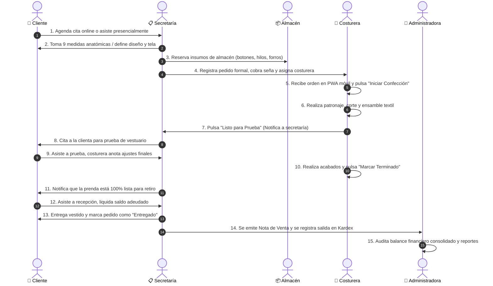

# MANUAL DE USUARIO Y FUNCIONAMIENTO DEL SISTEMA
## SISTEMA WEB & PWA DE GESTIÓN INTEGRAL DE ALTA COSTURA
### ATELIER "SIMONETTA MODAS"

---

## ÍNDICE GENERAL
1. [Introducción](#1-introducción)  
   1.1 [¿Quiénes usarán el sistema? (Roles y Funciones)](#11-quiénes-usarán-el-sistema-roles-y-funciones)  
2. [Requisitos Previos](#2-requisitos-previos)  
   2.1 [Requisitos de Hardware y Dispositivos para el Taller](#21-requisitos-de-hardware-y-dispositivos-para-el-taller)  
   2.2 [Requisitos Técnicos del Servidor](#22-requisitos-técnicos-del-servidor)  
3. [Instalación del Sistema](#3-instalación-del-sistema)  
   3.1 [Preparación del Servidor y Base de Datos](#31-preparación-del-servidor-y-base-de-datos)  
   3.2 [Configuración del Backend (API REST)](#32-configuración-del-backend-api-rest)  
   3.3 [Configuración y Compilación del Frontend (PWA)](#33-configuración-y-compilación-del-frontend-pwa)  
4. [Encender y Apagar el Sistema](#4-encender-y-apagar-el-sistema)  
   4.1 [Puesta en Marcha en Producción](#41-puesta-en-marcha-en-producción)  
   4.2 [Procedimiento de Apagado y Mantenimiento](#42-procedimiento-de-apagado-y-mantenimiento)  
5. [Inicio de Sesión y Seguridad](#5-inicio-de-sesión-y-seguridad)  
   5.1 [Acceso al Sistema (Personal vs Clientes)](#51-acceso-al-sistema-personal-vs-clientes)  
   5.2 [Política de Seguridad y Bloqueo por Intentos Fallidos](#52-política-de-seguridad-y-bloqueo-por-intentos-fallidos)  
   5.3 [Registro de Nuevos Clientes y Nuevos Usuarios](#53-registro-de-nuevos-clientes-y-nuevos-usuarios)  
6. [Módulo del Administrador](#6-módulo-del-administrador)  
   6.1 [Dashboard Central y Métricas Financieras](#61-dashboard-central-y-métricas-financieras)  
   6.2 [Gestión de Usuarios y Personal de Taller](#62-gestión-de-usuarios-y-personal-de-taller)  
   6.3 [Gestión Integral de Clientes y Recuperación de Accesos](#63-gestión-integral-de-clientes-y-recuperación-de-accesos)  
   6.4 [Gestión de Almacén, Inventario y Kardex](#64-gestión-de-almacén-inventario-y-kardex)  
   6.5 [Control y Seguimiento de Pedidos](#65-control-y-seguimiento-de-pedidos)  
   6.6 [Reportes Financieros y Notas de Venta Digitales](#66-reportes-financieros-y-notas-de-venta-digitales)  
7. [Módulo de la Secretaría](#7-módulo-de-la-secretaría)  
   7.1 [Calendario Interactivo Multimes y Navegación](#71-calendario-interactivo-multimes-y-navegación)  
   7.2 [Gestión y Atención de Citas](#72-gestión-y-atención-de-citas)  
   7.3 [Creación de Pedidos de Alta Costura](#73-creación-de-pedidos-de-alta-costura)  
   7.4 [Edición de Pedidos Existentes](#74-edición-de-pedidos-existentes)  
   7.5 [Recepción de Entregas y Liquidación de Saldos](#75-recepción-de-entregas-y-liquidación-de-saldos)  
   7.6 [Monitoreo Rápido de Almacén](#76-monitoreo-rápido-de-almacén)  
8. [Módulo de la Costurera (Taller / Mobile PWA)](#8-módulo-de-la-costurera-taller--mobile-pwa)  
   8.1 [Interfaz Móvil y Acceso Rápido](#81-interfaz-móvil-y-acceso-rápido)  
   8.2 [Cola de Tareas de Confección Asignadas](#82-cola-de-tareas-de-confección-asignadas)  
   8.3 [Consulta de Medidas Anatómicas y Notas de Diseño](#83-consulta-de-medidas-anatómicas-y-notas-de-diseño)  
   8.4 [Transición de Etapas de Confección](#84-transición-de-etapas-de-confección)  
   8.5 [Perfil del Personal del Taller](#85-perfil-del-personal-del-taller)  
9. [Módulo del Cliente](#9-módulo-del-cliente)  
   9.1 [Portal Personal del Cliente](#91-portal-personal-del-cliente)  
   9.2 [Catálogo de Moda y Solicitud de Citas](#92-catálogo-de-moda-y-solicitud-de-citas)  
   9.3 [Seguimiento de Confección en Tiempo Real](#93-seguimiento-de-confección-en-tiempo-real)  
   9.4 [Historial de Pagos, Saldos y Notas de Venta](#94-historial-de-pagos-saldos-y-notas-de-venta)  
10. [Flujo de Trabajo Completo (Ciclo de Vida de un Pedido)](#10-flujo-de-trabajo-completo-ciclo-de-vida-de-un-pedido)  
11. [Problemas Frecuentes y Soluciones](#11-problemas-frecuentes-y-soluciones)  
12. [Glosario de Términos](#12-glosario-de-términos)  

---

## 1. INTRODUCCIÓN

El **Sistema de Gestión Integral para Simonetta Modas** es una plataforma tecnológica desarrollada bajo el paradigma de Aplicación Web Progresiva (**PWA - Progressive Web App**) y arquitectura cliente-servidor desacoplada (Frontend React Vite + Backend Node.js Express + Base de Datos Relacional PostgreSQL).

Su propósito central es modernizar, automatizar y sincronizar en tiempo real todas las operaciones de un atelier o taller de alta costura, abarcando desde el primer contacto comercial con el cliente, el registro antropométrico detallado (medidas anatómicas o industriales), la gestión de inventario y Kardex de materiales textiles, el cronograma de patronaje, confección y pruebas, hasta la entrega final de la prenda y el balance financiero.

El sistema está orientado específicamente para:
* **Talleres y Casas de Moda de Alta Costura** que confeccionan vestidos de novia, vestidos de fiesta/gala, corsetería, trajes sastre y prendas tradicionales a medida.
* **Personal Directivo y Administrativo** que necesita trazabilidad operativa, control de materias primas y reportes de liquidez en tiempo real.
* **Secretaría y Recepción** para coordinar agendas, citas, anticipos y recepción de clientes con validaciones ágiles y precisas.
* **Maestras Costureras y Patronistas** que requieren visualizar órdenes de trabajo, especificaciones técnicas y medidas exactas desde dispositivos táctiles o teléfonos móviles al pie de sus máquinas de costura.
* **Clientes Finales** (particulares e instituciones) que demandan transparencia, seguimiento paso a paso de sus pedidos y comprobantes de venta digitales.

---

### 1.1 ¿Quiénes usarán el sistema? (Roles y Funciones)

La plataforma cuenta con un sistema de Control de Acceso Basado en Roles (**RBAC - Role-Based Access Control**) que delimita rigurosamente los privilegios y vistas:

| Rol | Usuario Típico | Responsabilidad Principal | Acciones y Alcance dentro del Sistema |
| :--- | :--- | :--- | :--- |
| **Administrador / Administradora** | Gerencia General, Propietaria del Atelier | Dirección general, auditoría, finanzas y control integral. | • Visualiza métricas financieras globales (ingresos, saldos pendientes, costo de inventario).<br>• Crea, suspende y administra cuentas de usuarios y roles del personal.<br>• Gestiona el catálogo maestro de clientes (edición, clasificación por persona o empresa, reseteo de claves olvidadas).<br>• Control total de Almacén: registro de compras, control de stock mínimo y Kardex.<br>• Emisión y exportación de reportes PDF/Excel y notas de venta con envío por correo electrónico.<br>• Intervención y anulación de cualquier pedido en caso de contingencia. |
| **Secretaría** | Recepcionista, Encargada de Atención al Cliente | Atención en mostrador, agendamiento, formalización de pedidos y entregas. | • Gestión del calendario interactivo (navegación mensual de citas, pruebas y entregas).<br>• Registro y atención de citas presenciales o solicitadas vía web.<br>• Creación formal de pedidos de alta costura: registro de medidas (9 medidas anatómicas o tallas estándar por edad y género), selección de telas, insumos del taller o traídos por cliente.<br>• Registro de anticipos (efectivo, QR, transferencia), asignación obligatoria de costurera.<br>• Entrega final de pedidos al cliente y cobro del saldo restante una vez concluida la confección.<br>• Consulta de inventario en modo lectura. |
| **Costurera** | Modista, Patronista, Operaria de Confección | Transformación de materia prima, patronaje, ensamble y acabado textil. | • Uso de la interfaz móvil adaptada a pantallas táctiles (PWA móvil).<br>• Visualización de sus prendas asignadas ordenadas por fecha de prueba y entrega.<br>• Consulta de medidas anatómicas del cliente, tabla de tallas y notas de diseño.<br>• Transición controlada del estado de la prenda: *Pendiente* $\rightarrow$ *En Confección* $\rightarrow$ *Prueba* $\rightarrow$ *Terminado*.<br>• Recepción de notificaciones automáticas ante nuevos pedidos o cambios. |
| **Cliente** | Persona Natural o Institución / Comparsa | Seguimiento de su encargo y comunicación con el taller. | • Acceso a su portal privado desde su teléfono u ordenador.<br>• Exploración del catálogo fotográfico de prendas de alta costura.<br>• Agendamiento de citas para toma de medidas o cotización.<br>• Seguimiento en tiempo real de la fase en que se encuentra su vestido.<br>• Consulta de abonos realizados, saldo adeudado y notas de venta electrónicas. |

---

## 2. REQUISITOS PREVIOS

### 2.1 Requisitos de Hardware y Dispositivos para el Taller

Para que el personal interactúe fluidamente con la plataforma, el taller debe contar con la siguiente infraestructura básica:

1. **Equipo de Recepción / Administración (Secretaría y Gerencia):**
   * Computadora de escritorio o Laptop (Windows 10/11, macOS o Linux).
   * Pantalla con resolución mínima recomendada de 1366x768 píxeles (ideal 1920x1080).
   * 4 GB de memoria RAM como mínimo.
   * Navegador web moderno: Google Chrome, Microsoft Edge, Mozilla Firefox o Safari actualizado.
   * Conexión a red local cableada (Ethernet) o Wi-Fi estable.

2. **Dispositivos para Costureras en Taller:**
   * Teléfono inteligente (Smartphone) o Tableta (Android 8.0+ o iOS 14+).
   * Pantalla táctil de al menos 5.5 pulgadas para cómoda visualización de tablas de medidas.
   * Navegador móvil: Chrome Mobile o Safari Mobile.
   * Conexión a la red Wi-Fi interna del taller.
   * Capacidad de instalar la PWA en la pantalla de inicio (opción "Agregar a pantalla principal").

3. **Conectividad de Red:**
   * Enrutador (Router) Wi-Fi que brinde cobertura a recepción y a la zona de máquinas de confección.
   * Conexión a Internet si se requiere el envío de correos automatizados (SMTP Gmail) y notificaciones Push (Firebase FCM). Si no hay internet externo, el sistema puede operar en red local cerrada (LAN).

---

### 2.2 Requisitos Técnicos del Servidor

El servidor puede ser una computadora dedicada en el taller, una mini-PC tipo servidor local o un Servidor Privado Virtual (VPS en la nube):

* **Sistema Operativo:** Ubuntu Server 22.04 / 24.04 LTS (o Windows 10/11 / Windows Server).
* **Procesador (CPU):** 2 núcleos a 2.0 GHz o superior (Intel Core i3 / AMD Ryzen 3 / vCPU equivalente).
* **Memoria RAM:** 4 GB de RAM mínimo (8 GB recomendados si la base de datos almacena años de historial).
* **Almacenamiento:** Unidad de Estado Sólido (SSD) con al menos 20 GB de espacio libre disponible.
* **Entorno de Ejecución (Runtime):** Node.js versión LTS (v18.x, v20.x o superior) con gestor de paquetes npm.
* **Motor de Base de Datos:** PostgreSQL versión 14, 15 o 16.
* **Servidor Web / Proxy Inverso:** Nginx (para entornos Linux) o ejecución directa mediante procesos gestionados con PM2.

---

## 3. INSTALACIÓN DEL SISTEMA

A continuación se detallan los pasos técnicos para desplegar el sistema en el servidor del taller.

### 3.1 Preparación del Servidor y Base de Datos

1. **Instalar Node.js y PostgreSQL:**
   * Descargar e instalar Node.js (versión LTS) desde el sitio oficial `nodejs.org`.
   * Descargar e instalar PostgreSQL desde `postgresql.org`.
2. **Crear la Base de Datos:**
   * Abrir la terminal o herramienta gráfica (pgAdmin o psql) y ejecutar:
   ```sql
   CREATE DATABASE simonetta_modas_db;
   ```
3. **Restaurar el Esquema y Tablas:**
   * Ubicar el archivo de migración e inicialización en `backend/db/init.sql`.
   * Ejecutar el script SQL para crear las tablas relacionales, catálogos y restricciones:
   ```bash
   psql -U postgres -d simonetta_modas_db -f backend/db/init.sql
   ```
   *(Alternativamente, puede ejecutarse `node backend/db/migrate_v2.js` para aplicar las migraciones automáticas).*

---

### 3.2 Configuración del Backend (API REST)

1. Abrir una terminal en el directorio `backend/`.
2. Instalar las dependencias de producción:
   ```bash
   npm install
   ```
3. Crear y verificar el archivo de variables de entorno `backend/.env` con los parámetros del taller:
   ```env
   PORT=3000
   NODE_ENV=production
   DB_USER=postgres
   DB_PASSWORD=tu_password_seguro
   DB_HOST=localhost
   DB_PORT=5432
   DB_NAME=simonetta_modas_db
   JWT_SECRET=clave_secreta_super_segura_simonetta_2026
   JWT_EXPIRES_IN=8h
   
   # Configuración de Correo Electrónico (Notificaciones de notas de venta)
   EMAIL_HOST=smtp.gmail.com
   EMAIL_PORT=465
   EMAIL_USER=simonetta.taller@gmail.com
   EMAIL_PASS=contraseña_de_aplicacion_gmail
   ADMIN_EMAIL=admin.simonetta@gmail.com
   ```
4. Ejecutar el script de siembra inicial (crea los roles, tipos de prendas, colores y usuarios base):
   ```bash
   node backend/db/semilla.js
   ```

---

### 3.3 Configuración y Compilación del Frontend (PWA)

1. Abrir una terminal en el directorio `frontend/`.
2. Instalar las dependencias de React:
   ```bash
   npm install
   ```
3. Configurar la URL de conexión al backend en `frontend/src/api/axios.js` o mediante el archivo `frontend/.env`:
   ```env
   VITE_API_URL=http://localhost:3000/api
   ```
   *(Si se accede desde teléfonos móviles de la red local, reemplazar `localhost` por la IP fija local del servidor, por ejemplo: `http://192.168.1.100:3000/api`)*.
4. Compilar los archivos de producción optimizados:
   ```bash
   npm run build
   ```
   Esto generará el paquete compilado en la carpeta `frontend/dist/` con el Service Worker y el manifiesto PWA listos para su distribución.

---

## 4. ENCENDER Y APAGAR EL SISTEMA

Para garantizar alta disponibilidad sin que el sistema se detenga al cerrar la consola, se recomienda utilizar el gestor de procesos **PM2**.

### 4.1 Puesta en Marcha en Producción

1. **Instalar PM2 globalmente (si no está instalado):**
   ```bash
   npm install -g pm2
   ```

2. **Iniciar el Servidor Backend:**
   * Dirigirse a la carpeta `backend/` y ejecutar:
   ```bash
   pm2 start server.js --name "simonetta-backend"
   ```

3. **Iniciar o Servir el Frontend:**
   * Puede servirse la carpeta compilada `frontend/dist/` mediante Nginx, o utilizando el servidor estático ligero `serve`:
   ```bash
   pm2 start "npx serve -s dist -l 5173" --name "simonetta-frontend" --cwd "./frontend"
   ```
   *(Para modo de desarrollo continuo, se puede ejecutar en dos terminales independientes: `npm start` en backend y `npm run dev` en frontend).*

4. **Verificar Estado de los Procesos:**
   ```bash
   pm2 status
   ```
   Ambos servicios (`simonetta-backend` y `simonetta-frontend`) deberán figurar con estado `online`.

5. **Guardar Configuración para Inicio Automático con el Sistema Operativo:**
   ```bash
   pm2 save
   pm2 startup
   ```

---

### 4.2 Procedimiento de Apagado y Mantenimiento

Cuando sea necesario realizar copias de seguridad de la base de datos o mantenimiento del servidor:

1. **Detener temporalmente los servicios:**
   ```bash
   pm2 stop all
   ```
2. **Reiniciar los servicios tras el mantenimiento:**
   ```bash
   pm2 restart all
   ```
3. **Apagar por completo los procesos si se va a apagar el servidor físico:**
   ```bash
   pm2 delete all
   ```

---

## 5. INICIO DE SESIÓN Y SEGURIDAD

### 5.1 Acceso al Sistema (Personal vs Clientes)

El punto de entrada al sistema se encuentra en la ruta `/login`.

> 📸 *[Captura 5.1: Pantalla Principal de Inicio de Sesión con campos de Correo, Contraseña, Captcha de Seguridad y botones de acceso]*

#### Pasos para Iniciar Sesión:
1. Abrir el navegador e ingresar a la dirección web del taller (ejemplo: `http://192.168.1.100:5173` o el dominio asignado).
2. Introducir el **Correo Electrónico** registrado.
3. Introducir la **Contraseña**.
4. Resolver el código numérico del **Captcha de Seguridad** (diseñado para impedir ataques de fuerza bruta automatizados).
5. Hacer clic en el botón **"Iniciar Sesión"**.
6. **Redirección Automática por Rol:**
   * Si el usuario es **Administrador/a**, el sistema lo dirigirá a `/admin`.
   * Si es **Secretaría**, se abrirá la vista de recepción en `/secretaria`.
   * Si es **Costurera**, se abrirá la interfaz táctil en `/mobile`.
   * Si es **Cliente**, se abrirá el portal personal en `/cliente`.

---

### 5.2 Política de Seguridad y Bloqueo por Intentos Fallidos

Para proteger la integridad de las cuentas del taller:
* **Límite de Intentos:** Si un usuario introduce una contraseña errónea **3 veces consecutivas**, el sistema activa una bandera de protección.
* **Bloqueo Temporal:** La cuenta queda suspendida temporalmente por un lapso exacto de **1 minuto (60 segundos)**.
* **Mensaje de Alerta:** Durante ese periodo, el sistema mostrará una advertencia clara indicando los segundos restantes antes de permitir un nuevo intento. Pasado el minuto, el contador se restablece automáticamente.

> 📸 *[Captura 5.2: Mensaje de alerta en pantalla de bloqueo temporal tras 3 intentos fallidos de autenticación]*

---

### 5.3 Registro de Nuevos Clientes y Nuevos Usuarios

#### Registro de Clientes:
* Los clientes pueden autoregistrarse desde el enlace **"¿Eres nuevo cliente? Regístrate aquí"** en la pantalla de inicio de sesión, completando su nombre, teléfono, carnet o NIT y correo electrónico.
* También pueden ser registrados de forma directa por la **Secretaría** al agendar una cita o por la **Administradora** desde el módulo de Clientes.

#### Registro de Usuarios Internos (Personal del Taller):
* Por estrictas razones de seguridad interna, **las costureras, secretarias y administradores NO pueden autoregistrarse en línea**.
* Su alta es potestad exclusiva de la **Administradora** desde la sección **Usuarios** del Dashboard.

> 📸 *[Captura 5.3: Modal de registro de nuevo usuario desde el módulo de administración, con selección de rol]*

---

## 6. MÓDULO DEL ADMINISTRADOR

El rol de Administrador posee privilegios globales para consultar, modificar y auditar cualquier aspecto del negocio.

### 6.1 Dashboard Central y Métricas Financieras
Al ingresar, la administradora visualiza de forma inmediata los indicadores clave de rendimiento (KPIs):
* **Ingresos Totales:** Suma consolidada de pagos iniciales y abonos cobrados.
* **Saldos por Cobrar:** Monto total de dinero pendiente de clientes con pedidos en proceso o listos para retiro.
* **Pedidos en Confección:** Conteo de órdenes actualmente en taller.
* **Alertas de Stock:** Alertas visuales inmediatas de materiales que han alcanzado su nivel mínimo de reposición.

> 📸 *[Captura 6.1: Pantalla principal del Dashboard del Administrador con tarjetas de métricas y gráficos de rendimiento]*

---

### 6.2 Gestión de Usuarios y Personal de Taller
Ruta: `/admin/usuarios`

Permite mantener el equipo de trabajo organizado:
1. **Ver Listado de Personal:** Tabla con nombre, correo, rol asignado y estado (Activo / Inactivo).
2. **Crear Nuevo Usuario:** 
   * Pulsar en **"+ Nuevo Usuario"**.
   * Ingresar correo corporativo y contraseña inicial de acceso.
   * Seleccionar el rol: *Secretaria*, *Costurera* o *Administradora*.
   * Guardar cambios.
3. **Modificar o Dar de Baja:** Opción para desactivar el acceso de un empleado que ya no trabaje en el taller sin eliminar el historial de pedidos confeccionados.

> 📸 *[Captura 6.2: Tabla de gestión de usuarios con botones de acción para editar rol y estado]*

---

### 6.3 Gestión Integral de Clientes y Recuperación de Accesos
Ruta: `/admin/clientes`

El taller atiende tanto a damas particulares como a colegios, comparsas y empresas:
1. **Filtros por Tipo de Cliente:**
   * Pestaña **"Todos"**, **"Personas Naturales"** y **"Institucionales / Empresas"**.
2. **Búsqueda Dinámica:** Filtrar al instante por nombre, carnet de identidad, NIT o teléfono celular.
3. **Edición de Datos de Contacto:**
   * Pulsar el botón **"✏️ Editar"** para actualizar dirección, teléfono de WhatsApp o razón social.
4. **Recuperación y Reseteo de Contraseñas (Función Exclusiva del Administrador):**
   * Si un cliente olvida su clave, el administrador pulsa **"🔑 Resetear Contraseña"**.
   * El sistema genera una contraseña temporal segura, actualiza el registro y permite compartirla directamente con el cliente.
5. **Historial de Pedidos:** Al hacer clic en un cliente, se despliega el historial histórico de todos sus encargos y estados de cuenta.

> 📸 *[Captura 6.3: Vista de clientes con pestañas de personas e instituciones y modal de restablecimiento de contraseña]*

---

### 6.4 Gestión de Almacén, Inventario y Kardex
Ruta: `/admin/almacen`

Control milimétrico de materias primas para evitar desabastecimientos:
1. **Modal de Creación Amplio:** Diseñado con interfaz fluida sin barras horizontales molestas.
2. **Catálogo de Materiales:** Registro de telas (seda, encaje, raso, terciopelo), avíos (botones, cierres invisibles, hilos, pedrería) con sus unidades (metros, piezas, rollos).
3. **Registro de Entradas (Compras):**
   * Seleccionar el material e ingresar la cantidad adquirida, precio unitario y comprobante de compra. El stock actual se incrementa automáticamente.
4. **Kardex y Trazabilidad:** Registro inmutable de cada movimiento indicando fecha, usuario que lo autorizó y motivo.
5. **Diferenciación de Materiales de Clientes:**
   * Si un cliente aporta su propia tela importada, el sistema la ingresa como *Material de Cliente*, permitiendo registrar su custodia sin mezclarlo contablemente con el patrimonio del taller.

> 📸 *[Captura 6.4: Interfaz de almacén mostrando el inventario con semáforos de stock bajo y modal de entrada de insumos]*

---

### 6.5 Control y Seguimiento de Pedidos
Ruta: `/admin/pedidos`

Panel maestro para supervisar la línea de producción:
* **Filtros Rápidos por Estado:**
  * `📋 Todos`
  * `⏳ Pendientes` (Pedidos recién formulados)
  * `🧵 En Confección` (Prendas en corte, armado, costura o prueba)
  * `✨ Listos` (Prendas terminadas esperando retiro)
  * `✅ Entregados` (Pedidos saldados y recogidos)
* **Visualización de Pagos y Abonos:** Botón `💰 Ver Pagos` para consultar cada abono registrado o ingresar abonos especiales autorizados por gerencia.

> 📸 *[Captura 6.5: Tabla general de pedidos con selector de estados, saldos en rojo/verde y detalle de costurera asignada]*

---

### 6.6 Reportes Financieros y Notas de Venta Digitales
Ruta: `/admin/reportes`

1. **Balance de Ingresos por Períodos:** Seleccionar rango de fechas (diario, semanal, mensual o anual).
2. **Exportación Formal:** Generación de archivos en formato **PDF formal** o planillas de cálculo **Excel (.xlsx)**.
3. **Notas de Venta Inmutables:**
   * Cada pedido genera un documento fiscal/comercial con folio correlativo, detalle de prendas, medidas, desglose de anticipo y saldo adeudado.
   * Envío automático por correo electrónico con copia al cliente y al archivo del taller.

> 📸 *[Captura 6.6: Pantalla de reportes con filtros de fecha y vista previa del formato de nota de venta formal]*

---

## 7. MÓDULO DE LA SECRETARÍA

La secretaría es el motor de atención al cliente y coordinación de citas del taller.

### 7.1 Calendario Interactivo Multimes y Navegación
Ruta: `/secretaria`

El calendario ocupa un lugar preponderante en la vista de secretaría para coordinar la capacidad del taller:
* **Controles de Navegación:**
  * Botón **"◀ Anterior"**: Desplaza la vista al mes previo (ej. septiembre).
  * Botón **"Hoy"**: Regresa de inmediato al mes y día corriente.
  * Botón **"Siguiente ▶"**: Avanza a los meses venideros (noviembre, diciembre, etc.).
* **Indicadores Visuales por Día:**
  * `📌 Cita programada`
  * `✂️ Prueba de vestuario`
  * `🏁 Entrega de pedido`
* **Creación Directa:** Al hacer clic sobre cualquier casillero de día del mes, se abre automáticamente el modal de creación de pedido con esa fecha preseleccionada.

> 📸 *[Captura 7.1: Calendario interactivo de la secretaría con navegación de meses e iconos de citas, pruebas y entregas]*

---

### 7.2 Gestión y Atención de Citas
* **Panel de Citas Pendientes:** Tarjetas con las citas agendadas por clientes web o por llamada telefónica.
* Muestra nombre del cliente, teléfono directo de WhatsApp y notas sobre el estilo de vestido que desea cotizar.
* **Botón "Crear Pedido":** Al atender a la clienta en el atelier, este botón abre la formalización del pedido traspasando automáticamente sus datos personales para evitar doble digitación.

> 📸 *[Captura 7.2: Tarjetas de citas pendientes de atención con acceso directo al botón de formalizar pedido]*

---

### 7.3 Creación de Pedidos de Alta Costura
El modal de registro de pedidos está diseñado bajo estrictas normas de validación:

1. **Paso 1: Cliente, Costurera y Fechas Clave:**
   * Seleccionar el cliente de la lista.
   * **Asignación Obligatoria de Costurera:** No se permite guardar si no se escoge la profesional responsable del vestido.
   * Fijar **Fecha de Prueba de Vestuario** y **Fecha de Entrega Final**. *(El sistema bloquea fechas pasadas o pruebas posteriores a la entrega)*.

2. **Paso 2: Prenda de Alta Costura y Paleta Panal de Abeja (30 Colores):**
   * **Tipo de Prenda:** Desplegable con tipologías confeccionables (*Vestido de Gala, Novia, 15 Años, Traje Sastre Dama/Caballero, Corset, Pollera Tradicional*, etc.) con tipografía oscura de alta legibilidad.
   * **Selector Honeycomb:** Panal interactivo de 30 hexágonos con la gama de colores de moda. Al hacer clic, se selecciona visualmente el color exacto.

3. **Paso 3: Sistema Dual de Patronaje (Medidas):**
   * **Opción A - Medidas Convencionales Industriales:**
     * Selección de Rango de Edad: *Adulto*, *Adolescente* o *Niño*.
     * Selección de Género: *Mujer* o *Varón*.
     * Selección de Talla: *XS, S, M, L, XL*. Al seleccionar, el sistema precarga las medidas corporales estandarizadas.
   * **Opción B - Alta Costura a Medida (9 Medidas Anatómicas):**
     * Para vestidos de gala y novia perfectos al cuerpo: *Busto, Cintura, Cadera, Espalda, Talle Cortas, Talle Frente, Ancho de Hombro, Alto de Cadera, Separación Entre Busto*.

4. **Paso 4: Insumos de Taller vs Insumos del Cliente:**
   * **Taller:** Búsqueda en almacén en tiempo real con validación estricta de stock disponible y prevención de insumos duplicados.
   * **Traídos por el Cliente:** Submenú tipificado con tipo de material, material base, color, metraje y unidad.

5. **Paso 5: Precios, Anticipo y Validación Matemática:**
   * Se ingresa el costo total y el anticipo o seña (mínimo exigido).
   * El sistema calcula en vivo el saldo restante. Los campos bloquean caracteres alfabéticos o símbolos matemáticos.

> 📸 *[Captura 7.3: Modal completo de creación de pedido mostrando el selector panal de colores y las 9 medidas anatómicas]*

---

### 7.4 Edición de Pedidos Existentes
* Permite modificar fechas de prueba reprogramadas por la clienta, agregar notas de ajuste tras la primera prueba o registrar pagos de amortización intermedia.

---

### 7.5 Recepción de Entregas y Liquidación de Saldos
* **Regla de Negocio del Atelier:** La secretaría tiene bloqueada la opción de marcar un pedido como *Entregado* mientras la costurera no lo haya finalizado formalmente en el taller (*Terminado*).
* Cuando la costurera termina la prenda, el selector de la secretaría se habilita:
  1. La clienta asiste a recepción.
  2. Cancela el saldo adeudado mediante el botón de registrar pago.
  3. La secretaría cambia el estado a **"Entregado"**.

> 📸 *[Captura 7.5: Lista de pedidos de secretaría con mensaje informativo de pedido en taller y selector habilitado para entrega]*

---

### 7.6 Monitoreo Rápido de Almacén
* Tarjeta lateral que muestra los niveles críticos de telas e insumos para advertir a la gerencia antes de aceptar pedidos voluminosos.

---

## 8. MÓDULO DE LA COSTURERA (TALLER / MOBILE PWA)

Diseñado con filosofía **Mobile-First**, ideal para ser utilizado en teléfonos móviles que las costureras mantienen en sus mesas de corte y máquinas de coser.

### 8.1 Interfaz Móvil y Acceso Rápido
* Barra de navegación inferior (**Bottom Navigation Bar**) táctil con accesos a **"🧵 Mis Tareas"** y **"👤 Mi Perfil"**.
* Compatible como Aplicación Web Progresiva (PWA): se puede instalar como icono directo en el celular sin pasar por Play Store o App Store.

> 📸 *[Captura 8.1: Vista móvil de la costurera con barra inferior de navegación y tarjeta de bienvenida]*

---

### 8.2 Cola de Tareas de Confección Asignadas
* La costurera solo ve los pedidos asignados a su persona, evitando confusiones con prendas de otras colegas.
* **Chips de Filtrado por Etapa:**
  * `Todos los activos`
  * `⏳ Pendientes`
  * `🧵 En Confección`
  * `📐 En Prueba`
  * `✨ Terminados`
* Cada tarjeta muestra: número de pedido, nombre de la clienta, tipo de prenda, color con chip visual, fecha de prueba y fecha límite de entrega.

> 📸 *[Captura 8.2: Listado de tarjetas de órdenes de confección con chips de filtrado superior y barra de progreso]*

---

### 8.3 Consulta de Medidas Anatómicas y Notas de Diseño
1. En cada tarjeta de pedido, la costurera dispone del botón **"Ver Medidas"**.
2. Al presionarlo, se abre un modal optimizado que despliega:
   * Si es talla estándar: el aviso de talla convencional.
   * Si es a medida: la cuadrícula clara en centímetros con busto, cintura, cadera, espalda, talle y hombro.
   * **Notas de Diseño Especiales:** Indicaciones de escote, tipo de cierre, adornos de pedrería o indicaciones del cliente.

> 📸 *[Captura 8.3: Modal táctil de medidas de confección con especificaciones anatómicas y notas de patronaje]*

---

### 8.4 Transición de Etapas de Confección
La costurera avanza la prenda a través de botones táctiles amplios (Touch target > 48px):

1. **Estado Inicial (Pendiente):**
   * Botón visible: **`🧵 Iniciar Confección`**.
   * Al pulsar, el estado avanza a **`En Confección`** (progreso 60%).
2. **Estado En Confección:**
   * La costurera realiza el corte, armado y patronaje preliminar.
   * Botón visible: **`📐 Listo para Prueba`**.
   * Al pulsar, el estado avanza a **`Prueba`** (progreso 85%). Se notifica a secretaría para llamar a la clienta.
3. **Estado En Prueba:**
   * Tras realizarse la prueba y ajustes menores en el atelier:
   * Botón visible: **`✓ Marcar Terminado`**.
   * Al pulsar, el estado pasa a **`Terminado`** (progreso 100%).
4. **Estado Terminado:**
   * El botón desaparece y se muestra el distintivo:  
     `✨ Confección Finalizada (Listo para Entrega en Secretaría)`.
   * *La costurera no puede marcar como Entregado, ya que la entrega y cobro final de dinero se realiza en recepción.*

> 📸 *[Captura 8.4: Botones táctiles de transición de confección según el estado actual de la orden de trabajo]*

---

### 8.5 Perfil del Personal del Taller
* Permite verificar los datos personales de la costurera, correo registrado y botón seguro para cerrar sesión.

---

## 9. MÓDULO DEL CLIENTE

El cliente accede con su correo y contraseña desde cualquier teléfono u ordenador.

### 9.1 Portal Personal del Cliente
Ruta: `/cliente`

* Vista elegante y limpia pensada para brindar una experiencia de alta costura exclusiva.
* Muestra el resumen de su perfil, teléfonos de contacto y medidas registradas en su ficha personal.

> 📸 *[Captura 9.1: Vista principal del portal del cliente con saludo personalizado y resumen de ficha]*

---

### 9.2 Catálogo de Moda y Solicitud de Citas
* Exploración de modelos de vestidos con fotografías, detalles de confección y silueta.
* Opción **"Agendar Cita"**: Selecciona fecha, hora preferente y notas del evento (ej. "Vestido para boda de noche en diciembre"). La solicitud aparece instantáneamente en el calendario de la secretaría.

> 📸 *[Captura 9.2: Catálogo de prendas y formulario modal para agendar cita desde el perfil del cliente]*

---

### 9.3 Seguimiento de Confección en Tiempo Real
* El cliente visualiza una barra de progreso que avanza automáticamente según la costurera trabaja en el taller:
  * *1. Pedido Registrado* $\rightarrow$ *2. En Taller / Confección* $\rightarrow$ *3. Cita para Prueba de Vestuario* $\rightarrow$ *4. Prenda Terminada Lista para Recoger* $\rightarrow$ *5. Entregado*.

> 📸 *[Captura 9.3: Barra de seguimiento en tiempo real del estado de confección de la prenda del cliente]*

---

### 9.4 Historial de Pagos, Saldos y Notas de Venta
* Desglose transparente de lo abonado y el saldo pendiente.
* Visualización y descarga de su nota de venta formal para constancia de su encargo.

---

## 10. FLUJO DE TRABAJO COMPLETO (CICLO DE VIDA DE UN PEDIDO)

A continuación se detalla el ciclo integral de una prenda en Simonetta Modas, involucrando secuencialmente a todos los roles del sistema:



### Descripción Paso a Paso del Flujo:

1. **Contacto y Agendamiento (Cliente $\rightarrow$ Secretaría):**  
   La clienta ingresa a la plataforma web o llama al atelier. Solicita una cita para un Vestido de Gala. La cita se refleja en color azul en el calendario de la secretaría.

2. **Recepción, Asesoría y Toma de Medidas (Secretaría $\rightarrow$ Cliente):**  
   La clienta asiste al taller. La secretaría abre la cita, selecciona el tipo de prenda (*Vestido de Gala*) y el color en el panal (*Azul Rey Cobalto*). Toma y digita las 9 medidas anatómicas (*busto, cintura, cadera, talle, etc.*) o selecciona la talla convencional.

3. **Asignación y Verificación de Materiales (Secretaría $\rightarrow$ Almacén):**  
   La secretaría asocia los 3 metros de seda y el cierre invisible necesarios. El sistema descuenta del stock en tiempo real y valida que haya existencias. Asigna obligatoriamente a la costurera especialista.

4. **Pago del Anticipo y Formalización (Secretaría $\rightarrow$ Cliente):**  
   Se define el costo total de Bs. 2.400 y se registra un anticipo de Bs. 1.200 (50%). El pedido queda formalizado en estado **"Pendiente"**.

5. **Recepción en Taller y Comienzo (Costurera):**  
   En su teléfono móvil, la costurera ve aparecer la nueva orden. Revisa las medidas y notas de escote. Presiona **"🧵 Iniciar Confección"**. El estado cambia a **"En Confección"**.

6. **Patronaje, Corte y Confección (Costurera):**  
   La costurera corta el tejido y ensambla las piezas principales. Al tener la prenda armada para el primer ajuste corporal, pulsa **"📐 Listo para Prueba"**.

7. **Prueba de Vestuario (Secretaría $\rightarrow$ Cliente $\rightarrow$ Costurera):**  
   La secretaría coordina la visita de la clienta según la fecha de prueba acordada. La clienta se prueba el vestido; la costurera ajusta alfileres y guarda observaciones menores en el sistema.

8. **Acabados Finales y Terminación (Costurera):**  
   La costurera cose dobladillos, plancha y verifica el acabado de alta costura. Al finalizar, pulsa **"✓ Marcar Terminado"**. El vestido queda rotulado como listo para entrega.

9. **Cobro de Saldo y Entrega de la Prenda (Secretaría $\rightarrow$ Cliente):**  
   La clienta acude al mostrador. La secretaría cobra el saldo restante de Bs. 1.200 registrando el pago (efectivo o QR), y procede a cambiar el estado a **"Entregado"**.

10. **Cierre Contable y Auditoría (Administración):**  
    El sistema genera la Nota de Venta digital que es remitida por correo. Los movimientos quedan asentados en el Kardex y la Administradora visualiza el ingreso en el balance general de fin de mes.

---

## 11. PROBLEMAS FRECUENTES Y SOLUCIONES

| # | Problema o Mensaje de Error | Causa Probable | Solución Paso a Paso |
| :-: | :--- | :--- | :--- |
| **1** | *"Cuenta bloqueada temporalmente. Espere 60 segundos"* | Se ingresó la contraseña errónea 3 veces consecutivas. | Esperar el minuto estipulado por seguridad. Pasado el tiempo, reintentar con la contraseña correcta verificando no tener activada la tecla Bloq Mayús. |
| **2** | El cliente olvidó su contraseña de acceso. | Pérdida o extravío de credenciales por parte del cliente. | La **Administradora** debe ingresar a `/admin/clientes`, ubicar al cliente y presionar el botón **"🔑 Resetear Contraseña"**. Se generará una clave temporal para que el cliente ingrese. |
| **3** | La secretaría no puede cambiar el estado de un pedido a *"Entregado"*. | El pedido aún se encuentra en etapa de taller (*Pendiente, En Confección o Prueba*). | Por regla del taller, la secretaría debe esperar a que la costurera termine la confección y presione **"✓ Marcar Terminado"** en su móvil. Solo entonces se habilitará la entrega. |
| **4** | *"Stock insuficiente para el insumo seleccionado"*. | Se intentó registrar una cantidad mayor a la existencia real en el almacén. | La Administradora debe registrar una nueva compra de material en el módulo de Almacén (`/admin/almacen`) antes de que el pedido pueda comprometer esas unidades. |
| **5** | En el selector de tipo de prenda de pedidos no se leía el texto. | Estilo de alto contraste o configuración antigua de navegador. | El problema fue subsanado en la versión actual fijando tipografía oscura `#0F172A` sobre fondo blanco `#FFFFFF`. Si persiste, actualizar la página con `Ctrl + F5` para refrescar la caché. |
| **6** | El calendario no avanza a meses futuros al presionar *"Siguiente"*. | Versión de script en caché local del navegador. | La función ha sido corregida y parametrizada con `fechaCalendario`. Presionar `Ctrl + Shift + R` en el navegador para recargar la versión más reciente del sistema. |
| **7** | La pantalla de la costurera en el teléfono móvil se quedaba en blanco. | Error de referencia en variables de estado de la versión previa. | Se corrigió implementando flags de estado protegidos y defensas contra nulos en `MobileDashboard.jsx`. Actualizar el navegador móvil o recargar la PWA. |
| **8** | No se reciben los correos de notas de venta. | Credenciales SMTP de Gmail no autorizadas o sin contraseña de aplicación. | Verificar en el archivo `backend/.env` que `EMAIL_USER` y `EMAIL_PASS` cuenten con una *Contraseña de Aplicación* de 16 caracteres de Google con verificación en dos pasos activa. |
| **9** | Los dispositivos móviles del taller no pueden conectarse al sistema. | El teléfono no está en la misma red Wi-Fi o la IP del servidor cambió. | Asegurarse de que el servidor tenga una IP fija local (ej. `192.168.1.100`) y que el celular de la costurera esté conectado a la misma red Wi-Fi interna del taller. |

---

## 12. GLOSARIO DE TÉRMINOS

* **Alta Costura (Haute Couture):** Confección de prendas de vestir exclusivas, diseñadas a medida de la silueta del cliente, con acabados manuales de máxima calidad y precisión técnica.
* **Medidas Anatómicas:** Conjunto de 9 dimensiones corporales reales tomadas sobre el cuerpo de la persona con cinta métrica (busto, cintura, cadera, espalda, talle frente, talle espalda/cortas, hombro, alto cadera y separación de busto).
* **Medidas Convencionales:** Tabla estándar de patronaje industrial agrupada por tallas comerciales (XS, S, M, L, XL) diferenciadas por segmento etario (Adulto, Adolescente, Niño) y género (Dama, Varón).
* **PWA (Progressive Web App - Aplicación Web Progresiva):** Aplicación construida con tecnologías web (HTML, CSS, React) que puede comportarse e instalarse en teléfonos móviles exactamente igual que una app nativa, con soporte fuera de línea y acceso directo.
* **Kardex:** Sistema de registro administrativo y contable estructurado para controlar el historial de entradas, salidas y existencias físicas de las materias primas del almacén.
* **Insumo Propio:** Material, tela o avío adquirido por el taller y registrado dentro del inventario valorizado del negocio.
* **Insumo de Cliente:** Tela o adorno exclusivo traído por la clienta para la elaboración de su vestido. Se registra para control de custodia pero no incrementa el costo contable del taller.
* **Anticipo / Seña:** Pago parcial inicial exigido por el atelier (habitualmente el 50%) para formalizar el contrato de confección y reservar los materiales y horas de costura.
* **Saldo:** Importe monetario remanente que la clienta debe liquidar al momento de recoger la prenda finalizada.
* **RBAC (Role-Based Access Control):** Mecanismo de seguridad informático que restringe o permite acciones dentro de una aplicación basándose en el rol asignado a la persona autenticada.
* **Captcha:** Mecanismo de seguridad visual que solicita al usuario resolver un reto (en este caso una operación o código numérico) para verificar que es un ser humano y no un bot malicioso.
* **JWT (JSON Web Token):** Estándar de seguridad cifrado que viaja en las cabeceras de red para mantener la sesión del usuario abierta y autenticada de manera segura.
* **Atelier:** Término de origen francés que designa el taller o estudio privado donde trabajan artesanos y modistas de alta costura.

---
*Manual elaborado para el sistema informático del Atelier Simonetta Modas. Todos los derechos reservados © 2026.*
